<!-- Generated by scripts/build.mjs from scripts/themes/matchday/README.template.md and
     refreshed by .github/workflows/profile.yml every 6 hours. Edit the template, not this file.
     Every image except the LeetCode card is generated from live GitHub data. -->

<picture>
    <source media="(prefers-color-scheme: dark)" srcset="https://github.com/Naveen-Boddepalli/Naveen-Boddepalli/blob/output/profile/hero-dark.svg?raw=true" />
    
  </picture>

## Scouting report

- **Position:** Full-stack developer and ML/AI engineer, B.Tech Computer Science (Year 3) at VIT Vellore
- **Style of play:** building intelligent, scalable and resilient systems, from 0 to 1
- **Current form:** shipping flowinger, query-lens and heurix
- **Strong foot:** Python, C++, TypeScript, JavaScript · Next.js, React, FastAPI, LangGraph, MongoDB
- **Honours:** 300+ LeetCode problems solved · GSSoC open-source contributor
- **Transfer status:** open to internships

> **Scout's notes.** I'm a third-year Computer Science student who believes software should solve real-world problems. Whether it's turning dense institutional research into an interactive market brief or teaching a pipeline to train its own forecasting models, I love building from 0 to 1. My latest obsession? Open-source contributions through GSSoC and diving deep into the intersection of electrical engineering and CS—because debouncing a noisy signal and debugging a flaky API have more in common than you'd think!

<!-- projects:start (generated by scripts/build.mjs, edit the pins instead) -->
<picture>
    <source media="(prefers-color-scheme: dark)" srcset="https://github.com/Naveen-Boddepalli/Naveen-Boddepalli/blob/output/profile/projects-header-dark.svg?raw=true" />
    
  </picture>
<a href="https://github.com/Naveen-Boddepalli/shadow-network">
  <picture>
    <source media="(prefers-color-scheme: dark)" srcset="https://github.com/Naveen-Boddepalli/Naveen-Boddepalli/blob/output/profile/project-1-dark.svg?raw=true" />
    
  </picture>
</a>
<a href="https://github.com/Naveen-Boddepalli/claude-desktop-mcp">
  <picture>
    <source media="(prefers-color-scheme: dark)" srcset="https://github.com/Naveen-Boddepalli/Naveen-Boddepalli/blob/output/profile/project-2-dark.svg?raw=true" />
    
  </picture>
</a>
<a href="https://github.com/Naveen-Boddepalli/flowinger">
  <picture>
    <source media="(prefers-color-scheme: dark)" srcset="https://github.com/Naveen-Boddepalli/Naveen-Boddepalli/blob/output/profile/project-3-dark.svg?raw=true" />
    
  </picture>
</a>
<a href="https://github.com/Naveen-Boddepalli/time-series-autoML">
  <picture>
    <source media="(prefers-color-scheme: dark)" srcset="https://github.com/Naveen-Boddepalli/Naveen-Boddepalli/blob/output/profile/project-4-dark.svg?raw=true" />
    
  </picture>
</a>
<a href="https://github.com/Naveen-Boddepalli/heurix">
  <picture>
    <source media="(prefers-color-scheme: dark)" srcset="https://github.com/Naveen-Boddepalli/Naveen-Boddepalli/blob/output/profile/project-5-dark.svg?raw=true" />
    
  </picture>
</a>
<a href="https://github.com/Naveen-Boddepalli/query-lens">
  <picture>
    <source media="(prefers-color-scheme: dark)" srcset="https://github.com/Naveen-Boddepalli/Naveen-Boddepalli/blob/output/profile/project-6-dark.svg?raw=true" />
    
  </picture>
</a>
<picture>
    <source media="(prefers-color-scheme: dark)" srcset="https://github.com/Naveen-Boddepalli/Naveen-Boddepalli/blob/output/profile/projects-footer-dark.svg?raw=true" />
    
  </picture>
<!-- projects:end -->

<!-- query:start (generated by scripts/build.mjs from profile.config.json) -->
Ask the VAR. Pick a review to open a pre-filled issue: a GitHub Action runs its SQL on [QueryLens](https://github.com/Naveen-Boddepalli/query-lens), my toy database engine, replies on the issue, and shows the decision here within a minute. Edit the issue title to write your own query.

<picture>
    <source media="(prefers-color-scheme: dark)" srcset="https://github.com/Naveen-Boddepalli/Naveen-Boddepalli/blob/query/query-result-dark.svg?raw=true" />
    
  </picture>

<a href="https://github.com/Naveen-Boddepalli/Naveen-Boddepalli/issues/new?title=sql%3A%20SELECT%20name%2C%20lang%20FROM%20projects%20WHERE%20demo%20IS%20NOT%20NULL%20ORDER%20BY%20pushed_days&amp;body=Submit%20this%20issue%20as%20it%20is%20and%20a%20GitHub%20Action%20runs%20the%20query%20on%20QueryLens%2C%20my%20toy%20SQL%20engine.%20It%20replies%20here%20and%20shows%20the%20result%20on%20my%20profile%20within%20a%20minute.%0A%0ATo%20write%20your%20own%20query%2C%20edit%20the%20title%20and%20keep%20the%20%60sql%3A%60%20prefix.%20You%20can%20query%3A%0A-%20%60projects%60%20(name%2C%20lang%2C%20stars%2C%20demo%2C%20pushed_days%2C%20pinned)%0A-%20%60languages%60%20(lang%2C%20bytes%2C%20share_pct)%0A-%20%60upstream_prs%60%20(repo%2C%20title%2C%20merged)%0A%0AOnly%20SELECT%20and%20EXPLAIN%20run%2C%20and%20a%20query%20may%20only%20use%20SQL%20keywords%2C%20these%20table%20and%20column%20names%2C%20numbers%2C%20and%20values%20that%20appear%20in%20the%20data."><picture><source media="(prefers-color-scheme: dark)" srcset="https://github.com/Naveen-Boddepalli/Naveen-Boddepalli/blob/output/profile/query-1-dark.svg?raw=true" /></picture></a> <a href="https://github.com/Naveen-Boddepalli/Naveen-Boddepalli/issues/new?title=sql%3A%20SELECT%20lang%2C%20share_pct%20FROM%20languages%20ORDER%20BY%20share_pct%20DESC&amp;body=Submit%20this%20issue%20as%20it%20is%20and%20a%20GitHub%20Action%20runs%20the%20query%20on%20QueryLens%2C%20my%20toy%20SQL%20engine.%20It%20replies%20here%20and%20shows%20the%20result%20on%20my%20profile%20within%20a%20minute.%0A%0ATo%20write%20your%20own%20query%2C%20edit%20the%20title%20and%20keep%20the%20%60sql%3A%60%20prefix.%20You%20can%20query%3A%0A-%20%60projects%60%20(name%2C%20lang%2C%20stars%2C%20demo%2C%20pushed_days%2C%20pinned)%0A-%20%60languages%60%20(lang%2C%20bytes%2C%20share_pct)%0A-%20%60upstream_prs%60%20(repo%2C%20title%2C%20merged)%0A%0AOnly%20SELECT%20and%20EXPLAIN%20run%2C%20and%20a%20query%20may%20only%20use%20SQL%20keywords%2C%20these%20table%20and%20column%20names%2C%20numbers%2C%20and%20values%20that%20appear%20in%20the%20data."><picture><source media="(prefers-color-scheme: dark)" srcset="https://github.com/Naveen-Boddepalli/Naveen-Boddepalli/blob/output/profile/query-2-dark.svg?raw=true" /></picture></a> <a href="https://github.com/Naveen-Boddepalli/Naveen-Boddepalli/issues/new?title=sql%3A%20SELECT%20repo%2C%20title%2C%20merged%20FROM%20upstream_prs%20ORDER%20BY%20merged%20DESC&amp;body=Submit%20this%20issue%20as%20it%20is%20and%20a%20GitHub%20Action%20runs%20the%20query%20on%20QueryLens%2C%20my%20toy%20SQL%20engine.%20It%20replies%20here%20and%20shows%20the%20result%20on%20my%20profile%20within%20a%20minute.%0A%0ATo%20write%20your%20own%20query%2C%20edit%20the%20title%20and%20keep%20the%20%60sql%3A%60%20prefix.%20You%20can%20query%3A%0A-%20%60projects%60%20(name%2C%20lang%2C%20stars%2C%20demo%2C%20pushed_days%2C%20pinned)%0A-%20%60languages%60%20(lang%2C%20bytes%2C%20share_pct)%0A-%20%60upstream_prs%60%20(repo%2C%20title%2C%20merged)%0A%0AOnly%20SELECT%20and%20EXPLAIN%20run%2C%20and%20a%20query%20may%20only%20use%20SQL%20keywords%2C%20these%20table%20and%20column%20names%2C%20numbers%2C%20and%20values%20that%20appear%20in%20the%20data."><picture><source media="(prefers-color-scheme: dark)" srcset="https://github.com/Naveen-Boddepalli/Naveen-Boddepalli/blob/output/profile/query-3-dark.svg?raw=true" /></picture></a> <a href="https://github.com/Naveen-Boddepalli/Naveen-Boddepalli/issues/new?title=sql%3A%20SELECT%20lang%2C%20COUNT(*)%20FROM%20projects%20GROUP%20BY%20lang&amp;body=Submit%20this%20issue%20as%20it%20is%20and%20a%20GitHub%20Action%20runs%20the%20query%20on%20QueryLens%2C%20my%20toy%20SQL%20engine.%20It%20replies%20here%20and%20shows%20the%20result%20on%20my%20profile%20within%20a%20minute.%0A%0ATo%20write%20your%20own%20query%2C%20edit%20the%20title%20and%20keep%20the%20%60sql%3A%60%20prefix.%20You%20can%20query%3A%0A-%20%60projects%60%20(name%2C%20lang%2C%20stars%2C%20demo%2C%20pushed_days%2C%20pinned)%0A-%20%60languages%60%20(lang%2C%20bytes%2C%20share_pct)%0A-%20%60upstream_prs%60%20(repo%2C%20title%2C%20merged)%0A%0AOnly%20SELECT%20and%20EXPLAIN%20run%2C%20and%20a%20query%20may%20only%20use%20SQL%20keywords%2C%20these%20table%20and%20column%20names%2C%20numbers%2C%20and%20values%20that%20appear%20in%20the%20data."><picture><source media="(prefers-color-scheme: dark)" srcset="https://github.com/Naveen-Boddepalli/Naveen-Boddepalli/blob/output/profile/query-4-dark.svg?raw=true" /></picture></a> <a href="https://github.com/Naveen-Boddepalli/Naveen-Boddepalli/issues/new?title=sql%3A%20EXPLAIN%20SELECT%20name%20FROM%20projects%20WHERE%20pinned%20%3D%201&amp;body=Submit%20this%20issue%20as%20it%20is%20and%20a%20GitHub%20Action%20runs%20the%20query%20on%20QueryLens%2C%20my%20toy%20SQL%20engine.%20It%20replies%20here%20and%20shows%20the%20result%20on%20my%20profile%20within%20a%20minute.%0A%0ATo%20write%20your%20own%20query%2C%20edit%20the%20title%20and%20keep%20the%20%60sql%3A%60%20prefix.%20You%20can%20query%3A%0A-%20%60projects%60%20(name%2C%20lang%2C%20stars%2C%20demo%2C%20pushed_days%2C%20pinned)%0A-%20%60languages%60%20(lang%2C%20bytes%2C%20share_pct)%0A-%20%60upstream_prs%60%20(repo%2C%20title%2C%20merged)%0A%0AOnly%20SELECT%20and%20EXPLAIN%20run%2C%20and%20a%20query%20may%20only%20use%20SQL%20keywords%2C%20these%20table%20and%20column%20names%2C%20numbers%2C%20and%20values%20that%20appear%20in%20the%20data."><picture><source media="(prefers-color-scheme: dark)" srcset="https://github.com/Naveen-Boddepalli/Naveen-Boddepalli/blob/output/profile/query-5-dark.svg?raw=true" /></picture></a>
<!-- query:end -->

<picture>
    <source media="(prefers-color-scheme: dark)" srcset="https://github.com/Naveen-Boddepalli/Naveen-Boddepalli/blob/output/profile/tactics-dark.svg?raw=true" />
    
  </picture>

<a href="https://github.com/pulls?q=is%3Apr%20is%3Amerged%20author%3ANaveen-Boddepalli%20-user%3ANaveen-Boddepalli">
  <picture>
    <source media="(prefers-color-scheme: dark)" srcset="https://github.com/Naveen-Boddepalli/Naveen-Boddepalli/blob/output/profile/upstream-dark.svg?raw=true" />
    
  </picture>
</a>

<b>Match reports:</b> what each GSSoC contribution changed

 

| Ground | Impact & Stack |
| :--- | :--- |
| **[im-anishraj/arnio](https://github.com/im-anishraj/arnio)** | Built custom validator registration system, UUID/IPv4/MAC-address semantic validators, and a redaction-aware HTML export. Extended `cast_types()` with structured error handling across C++ ↔ Python.   `Python` `C++` `pybind11` |
| **[Priyanshu-byte-coder/devtrack](https://github.com/Priyanshu-byte-coder/devtrack)** | Patched SSRF vulnerability (incl. IPv6 bypass), integrated Supabase Realtime sync via custom `useRealtimeSync` hook, and fortified CI for secure fork PR runs.   `TypeScript` `Supabase` `GitHub Actions` |
| **[SandeepVashishtha/Eventra](https://github.com/SandeepVashishtha/Eventra)** | Debugged and resolved service worker lifecycle issues, restoring seamless offline reliability.   `JavaScript` `PWA` |
| **[withfig/autocomplete](https://github.com/withfig/autocomplete)** | Contributed terminal CLI completion spec for the `xattr` command.   `TypeScript` `Fig` |

<picture>
    <source media="(prefers-color-scheme: dark)" srcset="https://github.com/Naveen-Boddepalli/Naveen-Boddepalli/blob/output/profile/stats-dark.svg?raw=true" />
    
  </picture>

  <a href="https://leetcode.com/u/NAVEEN2007B/">
    <picture>
      <source media="(prefers-color-scheme: dark)" srcset="https://leetcard.jacoblin.cool/NAVEEN2007B?theme=dark&font=Fira%20Code" />
      
    </picture>
  </a>
   
  <i>Training ground: daily drills on LeetCode.</i>

<picture>
    <source media="(prefers-color-scheme: dark)" srcset="https://github.com/Naveen-Boddepalli/Naveen-Boddepalli/blob/output/profile/heatmap-dark.svg?raw=true" />
    
  </picture>

## How the ratings work

Every rating on the player card is calculated from public GitHub data, every 6 hours.

 

Each rating runs from 40 to 99. The score is the square root of my number divided by an "elite" value, so early progress counts and the top is hard to reach. The overall rating is the weighted average below. The code is in [`scripts/ratings.mjs`](scripts/ratings.mjs).

| Rating | What it means | Calculated from | Weight in overall |
| :--- | :--- | :--- | ---: |
| **Pace** (PAC) | shipping cadence | median days since the last push across pinned repos (0 d = 99, 120 d or more = 40) | 15% |
| **Finishing** (FIN) | ships usable things | share of public repos with a live demo (elite 50%), plus stars (elite 300) | 20% |
| **Vision** (VIS) | range across languages | languages with at least 3% of code (elite 8) | 15% |
| **Teamwork** (TEA) | open-source play | merged PRs to other people's repos (elite 50) and how many repos (elite 15) | 20% |
| **Stamina** (STA) | volume this season | contributions this calendar year (elite 3000) | 15% |
| **Composure** (COM) | consistency | best daily contribution streak in the last year (elite 100 days) | 15% |

## Contact the agent

<a href="https://naveen-boddepalli-portfolio.vercel.app/"><picture><source media="(prefers-color-scheme: dark)" srcset="https://github.com/Naveen-Boddepalli/Naveen-Boddepalli/blob/output/profile/link-portfolio-dark.svg?raw=true" /></picture></a> <a href="https://www.linkedin.com/in/naveen-boddepalli-689056327/"><picture><source media="(prefers-color-scheme: dark)" srcset="https://github.com/Naveen-Boddepalli/Naveen-Boddepalli/blob/output/profile/link-linkedin-dark.svg?raw=true" /></picture></a> <a href="mailto:1234naveenboddepalli@gmail.com"><picture><source media="(prefers-color-scheme: dark)" srcset="https://github.com/Naveen-Boddepalli/Naveen-Boddepalli/blob/output/profile/link-mail-dark.svg?raw=true" /></picture></a> <a href="https://leetcode.com/u/NAVEEN2007B/"><picture><source media="(prefers-color-scheme: dark)" srcset="https://github.com/Naveen-Boddepalli/Naveen-Boddepalli/blob/output/profile/link-leetcode-dark.svg?raw=true" /></picture></a> <a href="https://x.com/N_Boddepalli"><picture><source media="(prefers-color-scheme: dark)" srcset="https://github.com/Naveen-Boddepalli/Naveen-Boddepalli/blob/output/profile/link-x-dark.svg?raw=true" /></picture></a>

<picture>
    <source media="(prefers-color-scheme: dark)" srcset="https://github.com/Naveen-Boddepalli/Naveen-Boddepalli/blob/output/profile/footer-dark.svg?raw=true" />
    
  </picture>
