<!-- Every image below except the stack icons, LeetCode card and snake is generated by
     scripts/build.mjs and refreshed by .github/workflows/profile.yml every 6 hours. -->

<picture>
    <source media="(prefers-color-scheme: dark)" srcset="https://github.com/Naveen-Boddepalli/Naveen-Boddepalli/blob/output/profile/hero-dark.svg?raw=true" />
    
  </picture>

## `\! cat about.txt`

```text
─────────────────────────────────────────────────────────────────────────
Role          : Full-Stack Developer & ML/AI Engineer (Year 3)
Education     : B.Tech Computer Science @ VIT Vellore
Focus         : Building intelligent, scalable, and resilient systems.
Current Quests: Shipping flowinger, query-lens & heurix
Languages     : Python, C++, TypeScript, JavaScript
Ecosystem     : Next.js, React, FastAPI, LangGraph, MongoDB
Milestones    : 300+ LeetCode Solutions, GSSoC Open Source Contributor
─────────────────────────────────────────────────────────────────────────
```

> I'm a third-year Computer Science student who believes software should solve real-world problems. Whether it's turning dense institutional research into an interactive market brief or teaching a pipeline to train its own forecasting models, I love building from 0 to 1. My latest obsession? Open-source contributions through GSSoC and diving deep into the intersection of electrical engineering and CS—because debouncing a noisy signal and debugging a flaky API have more in common than you'd think!

{{projects "SELECT name, about, lang, pushed, demo FROM pinned;"}}

## `\i your_query.sql`

{{query}}

## `\dx` installed extensions

<div>
  <h3>Programming Languages</h3>
  <p>
    <a href="https://skillicons.dev">
      
    </a>
  </p>
  <h3>Frameworks & Runtimes</h3>
  <p>
    <a href="https://skillicons.dev">
      
    </a>
  </p>
  <h3>Data, Cloud & CI/CD</h3>
  <p>
    <a href="https://skillicons.dev">
      
    </a>
  </p>
  <h3>AI / ML Arsenal</h3>
  <p>
    
    
    
    
    
  </p>
</div>

## `\! git log upstream`

<a href="https://github.com/pulls?q=is%3Apr%20is%3Amerged%20author%3ANaveen-Boddepalli%20-user%3ANaveen-Boddepalli">
  <picture>
    <source media="(prefers-color-scheme: dark)" srcset="https://github.com/Naveen-Boddepalli/Naveen-Boddepalli/blob/output/profile/upstream-dark.svg?raw=true" />
    
  </picture>
</a>

<details>
<summary><b>GSSoC highlights:</b> what each contribution changed</summary>
<br/>

| Repository | Impact & Stack |
| :--- | :--- |
| **[im-anishraj/arnio](https://github.com/im-anishraj/arnio)** | Built custom validator registration system, UUID/IPv4/MAC-address semantic validators, and a redaction-aware HTML export. Extended `cast_types()` with structured error handling across C++ ↔ Python. <br/> `Python` `C++` `pybind11` |
| **[Priyanshu-byte-coder/devtrack](https://github.com/Priyanshu-byte-coder/devtrack)** | Patched SSRF vulnerability (incl. IPv6 bypass), integrated Supabase Realtime sync via custom `useRealtimeSync` hook, and fortified CI for secure fork PR runs. <br/> `TypeScript` `Supabase` `GitHub Actions` |
| **[SandeepVashishtha/Eventra](https://github.com/SandeepVashishtha/Eventra)** | Debugged and resolved service worker lifecycle issues, restoring seamless offline reliability. <br/> `JavaScript` `PWA` |
| **[withfig/autocomplete](https://github.com/withfig/autocomplete)** | Contributed terminal CLI completion spec for the `xattr` command. <br/> `TypeScript` `Fig` |

</details>

<picture>
    <source media="(prefers-color-scheme: dark)" srcset="https://github.com/Naveen-Boddepalli/Naveen-Boddepalli/blob/output/profile/stats-dark.svg?raw=true" />
    
  </picture>

<div align="center">
  <a href="https://leetcode.com/u/NAVEEN2007B/">
    <picture>
      <source media="(prefers-color-scheme: dark)" srcset="https://leetcard.jacoblin.cool/NAVEEN2007B?theme=dark&font=Fira%20Code" />
      
    </picture>
  </a>
</div>

## `\watch contributions`

<div align="center">
  <picture>
    <source media="(prefers-color-scheme: dark)" srcset="https://github.com/Naveen-Boddepalli/Naveen-Boddepalli/blob/output/github-contribution-grid-snake-dark.svg?raw=true" />
    <source media="(prefers-color-scheme: light)" srcset="https://github.com/Naveen-Boddepalli/Naveen-Boddepalli/blob/output/github-contribution-grid-snake.svg?raw=true" />
    
  </picture>
  <br/>
  <sub><i>Hovering through the GitHub matrix, one green tile at a time.</i></sub>
</div>

## `\connect naveen`

<a href="https://naveen-boddepalli-portfolio.vercel.app/"><picture><source media="(prefers-color-scheme: dark)" srcset="https://github.com/Naveen-Boddepalli/Naveen-Boddepalli/blob/output/profile/link-portfolio-dark.svg?raw=true" /></picture></a> <a href="https://www.linkedin.com/in/naveen-boddepalli-689056327/"><picture><source media="(prefers-color-scheme: dark)" srcset="https://github.com/Naveen-Boddepalli/Naveen-Boddepalli/blob/output/profile/link-linkedin-dark.svg?raw=true" /></picture></a> <a href="mailto:1234naveenboddepalli@gmail.com"><picture><source media="(prefers-color-scheme: dark)" srcset="https://github.com/Naveen-Boddepalli/Naveen-Boddepalli/blob/output/profile/link-mail-dark.svg?raw=true" /></picture></a> <a href="https://leetcode.com/u/NAVEEN2007B/"><picture><source media="(prefers-color-scheme: dark)" srcset="https://github.com/Naveen-Boddepalli/Naveen-Boddepalli/blob/output/profile/link-leetcode-dark.svg?raw=true" /></picture></a> <a href="https://x.com/N_Boddepalli"><picture><source media="(prefers-color-scheme: dark)" srcset="https://github.com/Naveen-Boddepalli/Naveen-Boddepalli/blob/output/profile/link-x-dark.svg?raw=true" /></picture></a>

<picture>
    <source media="(prefers-color-scheme: dark)" srcset="https://github.com/Naveen-Boddepalli/Naveen-Boddepalli/blob/output/profile/footer-dark.svg?raw=true" />
    
  </picture>
